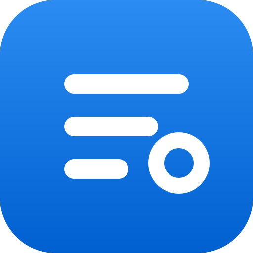
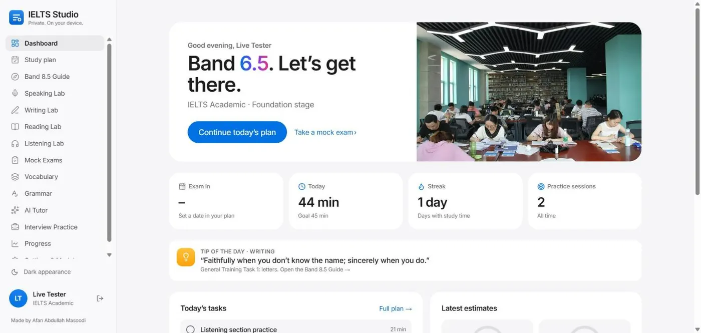
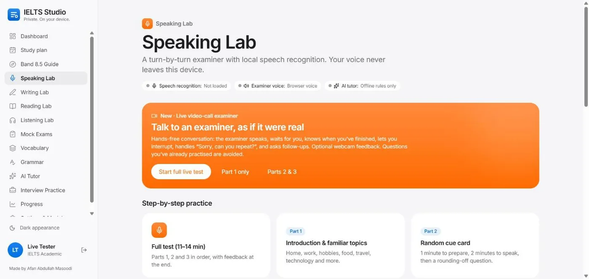
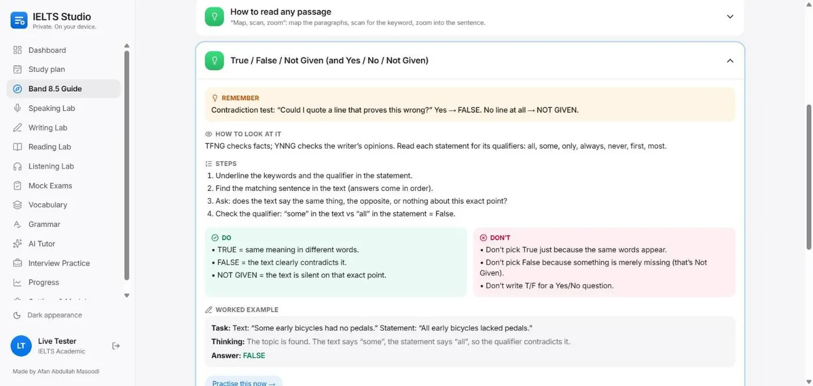
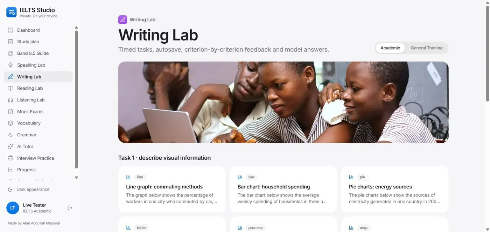

<div align="center">



# IELTS Studio

**Free, private IELTS preparation that runs entirely in your browser.**

Mock exams · a live voice examiner · writing feedback · a Band 8.5 strategy guide · on-device AI

**[▶ Open the app: ielitsafan.vercel.app](https://ielitsafan.vercel.app)**

Made by **Afan Abdullah Masoodi**

[](https://vercel.com/new/clone?repository-url=https%3A%2F%2Fgithub.com%2Fafanmasudi%2Fielitsafan&project-name=ielts-studio)
&nbsp;


</div>

<p align="center">
  
  
  
  
</p>

---

## What is it?

IELTS Studio is a complete IELTS practice platform for **Academic, General Training, UKVI and Life Skills (A1, A2 and B1)**. It has original Reading and Listening tests with instant marking, Writing and Speaking feedback on the four official criteria, full mock exams, a personal study plan, and a **live video-call examiner** that listens, waits for you and asks follow-up questions.

It is **private by design**:
- **No account and no server.** Your essays, recordings, CV and progress never leave your device.
- **No paid AI.** Speech recognition, the examiner's voice and the AI tutor run *inside your browser* using open models, downloaded only when you ask.
- **Works offline** once loaded, and can be installed like an app on phones and computers.

> IELTS Studio is an independent practice tool, not affiliated with the British Council, IDP or Cambridge University Press & Assessment. All scores are practice estimates, not official results.

---

## Features

| | |
|---|---|
| 🎙️ **Speaking** | A three-part examiner (Part 1 topics, a Part 2 cue card with 1-minute prep and a 2-minute talk, Part 3 discussion). A **live video-call mode**: it speaks, waits for you to finish, can be interrupted, handles "Sorry, can you repeat?", and asks follow-ups. Optional webcam feedback on eye contact and presence. |
| ✍️ **Writing** | Academic Task 1 (line, bar, pie, table, map, process, mixed), General Training letters and Task 2 essays. A timer, autosave, band estimates per criterion **with reasons**, highlighted errors, corrections, and model answers. |
| 📖 **Reading** | Full Academic and General Training tests (40 questions each) covering all 12 question types, with highlighting, a navigator, instant marking, and the exact line of text that proves each answer. |
| 🎧 **Listening** | A 4-part, 40-question test voiced in British and American English. Exam mode plays each recording once, as in the real test. |
| 📝 **Mock exams** | Full Academic, General Training and UKVI mocks with official half-band rounding, plus Life Skills A1/A2/B1 with a simulated partner and a Pass/Fail estimate. |
| 🧭 **Band 8.5 Guide** | How to approach every question type: what to look for, steps, do's and don'ts, a memory trick and a worked example. Covers trending topics such as AI. |
| 🧠 **Smart features** | A personal study plan, spaced-repetition vocabulary, grammar lessons, an AI tutor, CV-based interview practice, and progress analytics (mastery by question type, fluency trends, projection to your exam date). Questions you have practised before aren't repeated. |

---

## How to use it (no installation)

1. Go to **https://ielitsafan.vercel.app** in Chrome, Edge, Safari or Firefox (desktop or phone).
2. Click **Start for free** and create a profile (just a name, stored on your device).
3. Answer the five setup questions (test type, level, target, exam date, weak skills) and take the 12-question placement check.
4. Follow **Today's tasks** on the Dashboard, or open any lab from the menu.
5. *(Optional)* For speaking with your voice, open **Speaking Lab → Start full live test** and download the speech model when asked (about 41 MB, one time). Headphones work best.
6. *(Optional)* **Install it as an app:** in Chrome or Edge click the install icon in the address bar; on iPhone use Share → *Add to Home Screen*.

**Your data:** everything is saved in this browser only. Use **Settings → Data & privacy → Export** to back it up or move it to another device.

### Optional AI models

Open **Settings → Model manager**. Nothing downloads automatically.

| Model | Size | What it adds | Works on |
|---|---|---|---|
| Whisper Tiny | ~41 MB | Turns your spoken answers into text | Most phones and computers |
| Kokoro voice | ~92 MB | A natural British/American examiner voice | Most devices |
| MiniLM | ~23 MB | Understands "can you repeat?", checks answers stay on topic | Most devices |
| MediaPipe Face | ~4 MB | Webcam feedback in live calls | Most devices |
| Qwen3 (0.6B–4B) | 0.35–2.3 GB | AI tutor chat, written commentary, follow-up questions | Desktop Chrome/Edge with WebGPU |

Without any models the app still works: you can type answers, hear the browser's built-in voice, and the tutor answers from its built-in guide.

---

## Run it on your own computer

You need **[Node.js 20 or newer](https://nodejs.org/)** (the LTS version is fine) and **[Git](https://git-scm.com/)**.

```bash
# 1. Download the code
git clone https://github.com/afanmasudi/ielitsafan.git
cd ielitsafan

# 2. Install dependencies (takes a few minutes the first time)
npm install

# 3. Start the app
npm run dev
```

Then open **http://localhost:5173** in your browser.

Other commands:

```bash
npm test           # run the 122 automated tests
npm run lint       # check code style
npm run build      # create a production build in dist/
npm run preview    # serve the production build locally
```

> **Windows tip:** if `npm` isn't recognised after installing Node.js, close and reopen your terminal.

---

## Put your own copy online (free)

**Easiest:** click **Deploy with Vercel** at the top of this page, sign in with GitHub, and click **Deploy**. Vercel copies the repository to your account, builds it, and gives you a link such as `your-name.vercel.app`. No settings or environment variables are needed.

**Using the command line:**

```bash
npm i -g vercel
vercel login
vercel deploy --prod
```

**Other hosts** (Netlify, Cloudflare Pages and so on) also work: build with `npm run build` and publish the `dist/` folder. For the fastest in-browser AI, send these two headers, already set in `vercel.json`:

```
Cross-Origin-Opener-Policy: same-origin
Cross-Origin-Embedder-Policy: require-corp
```

Microphone and camera need **HTTPS**, which all of these hosts provide.

---

## How it works

- **Frontend:** React, TypeScript, Vite and Tailwind CSS, as a static site with no backend.
- **Storage:** IndexedDB (via Dexie), local to each browser. JSON export and import for backups.
- **On-device AI:** [Transformers.js](https://github.com/huggingface/transformers.js) (Whisper speech recognition, MiniLM), [kokoro-js](https://github.com/hexgrad/kokoro) (voice), [WebLLM](https://github.com/mlc-ai/web-llm) (Qwen3 tutor) and [MediaPipe](https://ai.google.dev/edge/mediapipe) (face tracking). All run in Web Workers, so the page stays responsive.
- **Scoring:** a separate, tested module that follows the official rounding rules. AI writes commentary only; it never invents band scores.

```
src/
  ai/          speech, voice, language-model and face workers
  lib/         scoring, analysers, turn-taking, study plan, storage
  content/     original tests, prompts, cue cards, vocabulary, strategy guide
  features/    test runners and the live examiner
  components/  UI building blocks
  pages/       one file per screen
```

More detail: [RESEARCH.md](RESEARCH.md) (sources and design decisions) · [MODEL_GUIDE.md](MODEL_GUIDE.md) (AI models) · [TESTING.md](TESTING.md) (test report).

---

## Limitations

- Writing and Speaking scores are **estimates from transparent rules**, not examiner marks. Expect about ±1 band.
- **Pronunciation is not scored.** A transcript can't show it, and accents are never penalised.
- The AI tutor needs WebGPU (desktop Chrome or Edge). Phones use the offline guide instead.
- One full test of each type is included so far; more can be added in `src/content/`.

---

## Contributing

Ideas, bug reports and new practice material are welcome. Open an **Issue** or a **Pull Request**. Please run `npm test` and `npm run lint` before submitting. All test content must be original (no copied IELTS book material).

## Licence and credits

Released under the **[MIT License](LICENSE)**: free to use, copy, change and share, with attribution.
© 2026 Afan Abdullah Masoodi.

Photos: public domain (CC0) via Wikimedia Commons (see [public/images/CREDITS.md](public/images/CREDITS.md)). AI models and libraries keep their own open-source licences (Apache-2.0 / MIT; Llama 3.2 under its community licence); see [MODEL_GUIDE.md](MODEL_GUIDE.md).
